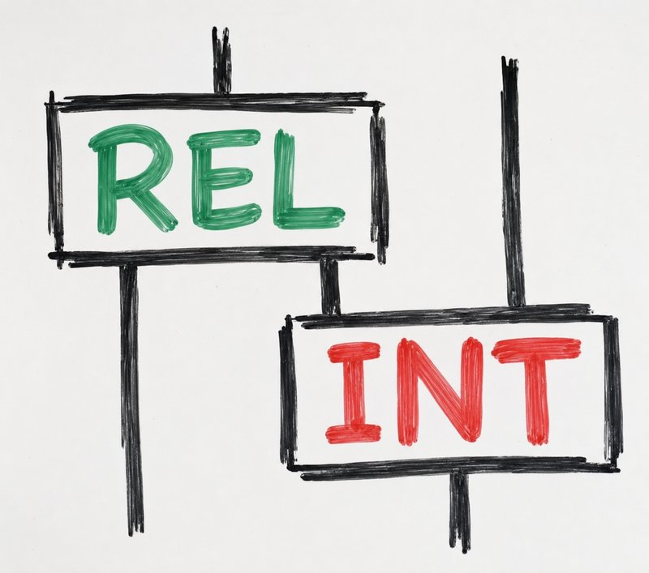

{: .logo-dark}
{: .logo-light}

# Relational Intelligence

Structured Language Models for efficient and responsible AI
{: .tagline}

- Efficiency
- Safety
- Quantum-ready
{: .pills}

---

## Structured Language Models

**Structured Language Models** are a new generation of AI models, free from the twin drawbacks of **brute force**{: .warn} (that leads to wasted data and compute) and **black boxes**{: .warn} (that leads to unexplainable answers, in other terms, hallucinations).

-  **Interpretable** Every answer comes with a proof, as a diagram you can inspect.
-  **Small by design** A fraction of the compute of brute-force models, and it learns from scarce data.
-  **Hardware-agnostic** The same model runs on GPUs today, and on photonic and quantum hardware next.
{: .cols-3}

- **16K parameters** solve 99% of extreme Sudoku after ten minutes on one GPU, seven orders of magnitude smaller than frontier LLMs which fail at the same problem. [arXiv:2610.18649](https://arxiv.org/abs/2610.18649)
- **1,000+ GitHub stars** for [DisCoPy](https://github.com/discopy/discopy), [lambeq](https://github.com/Quantinuum/lambeq) and [optyx](https://github.com/quantinuum-dev/optyx), the open-source software our field runs on.
{: .cols-2 .cards}

---

## A universal graphical language

Category theory unifies the diagrams every industry draws. We have developed it for 25 years, at Oxford and Quantinuum.

-  **2004** [CQM](https://en.wikipedia.org/wiki/Categorical_quantum_mechanics) Quantum theory in pictures.
-  **2007** [ZX-calculus](https://en.wikipedia.org/wiki/ZX-calculus) A complete language for quantum computing.
-  **2008** [DisCoCat](https://en.wikipedia.org/wiki/DisCoCat) The same pictures for the meaning of sentences.
-  **2020** [QNLP](https://en.wikipedia.org/wiki/Quantum_natural_language_processing) The first language processing on quantum hardware.
{: .cols-4 .halves .timeline}

Featured in [The Guardian](https://www.theguardian.com/science/2023/dec/16/physicist-bob-coecke-its-easier-to-convince-kids-than-adults-about-quantum-mechanics), [Forbes](https://www.forbes.com/sites/moorinsights/2021/10/13/cambridge-quantum-makes-quantum-natural-language-processing-a-reality/) and [New Scientist](https://www.newscientist.com/article/1955442-quantum-links-let-computers-understand-language/).
{: .muted}
