# People

At Oxford's [Quantum Group](https://www.cs.ox.ac.uk/activities/quantum/) we pioneered [categorical quantum mechanics](https://en.wikipedia.org/wiki/Categorical_quantum_mechanics), the [ZX-calculus](https://en.wikipedia.org/wiki/ZX-calculus), [DisCoCat](https://en.wikipedia.org/wiki/DisCoCat) and [quantum natural language processing](https://en.wikipedia.org/wiki/Quantum_natural_language_processing), and wrote [DisCoPy](https://discopy.org/) and [lambeq](https://github.com/Quantinuum/lambeq) along the way.

---

## Directors

- 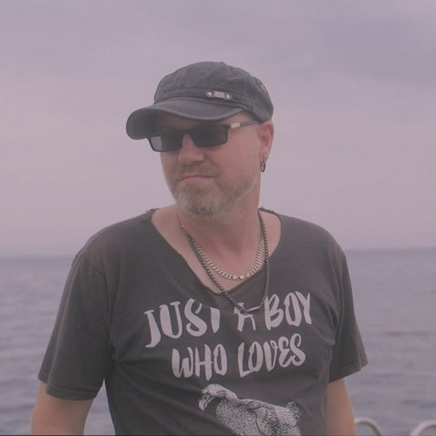 **[Bob Coecke](https://en.wikipedia.org/wiki/Bob_Coecke)** *CEO* Pioneer of CQM, ZX, DisCoCat and QNLP. 20 years at Oxford, former Chief Scientist at Quantinuum.
- 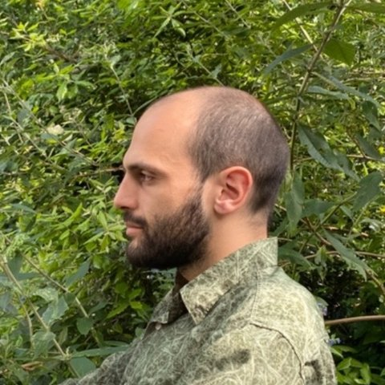 **[Giovanni de Felice](https://scholar.google.com/citations?user=-_bkN1gAAAAJ&hl=en)** *CSO* Co-creator of DisCoPy, quantum photonics specialist. Oxford PhD.
- 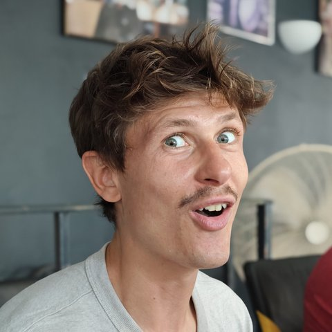 **[Alexis Toumi](http://alexis.toumi.xyz/)** *CTO* Creator of DisCoPy, applied category theorist and AI researcher. Oxford PhD.
- 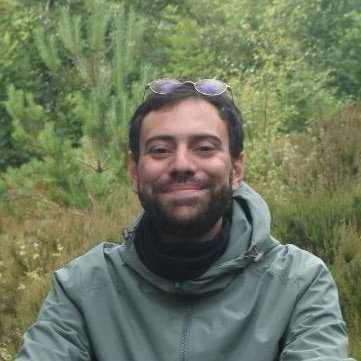 **[Tommaso Salvatori](https://scholar.google.com/citations?user=fG9vZC4AAAAJ)** *Head of ML* Neuroscience-inspired ML research at VERSES AI. Oxford PhD.
{: .cols-2 .halves .people}

---

## Team

- 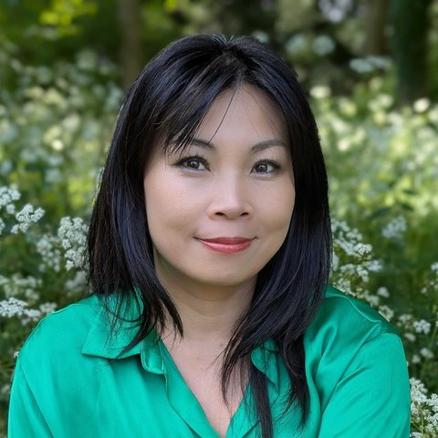 **[Destiny Chen](https://www.linkedin.com/in/destiny-chen-manager)** *Head of Operations* 15+ years running operations with Bob, in academia and industry.
- 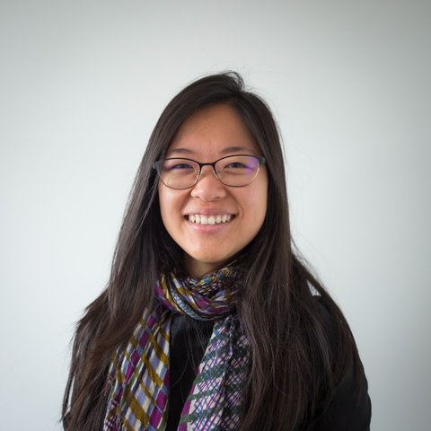 **[Daphne Wang](https://wangdaphne.github.io/)** *Member of Technical Staff* UCL PhD, previously at Quandela.
- 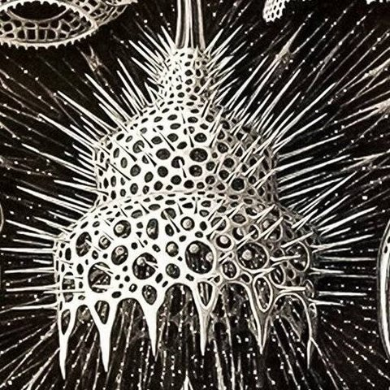 **Joseph** *Member of Technical Staff* Formal methods expert. EPFL graduate.
- 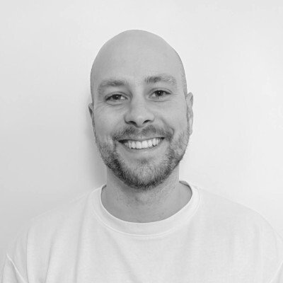 **Alexandre Chalard** *Member of Technical Staff* Full-stack AI engineer. Toulouse PhD, UCLA Neurology.
- 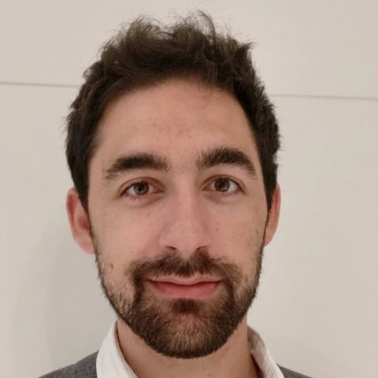 **[Matteo Forasassi](https://scholar.google.com/citations?user=md96RmMAAAAJ)** *Member of Technical Staff (part time)* TU Wien PhD candidate, Politecnico di Milano graduate.
{: .cols-2 .halves .people}

---

## Scientific advisors

- 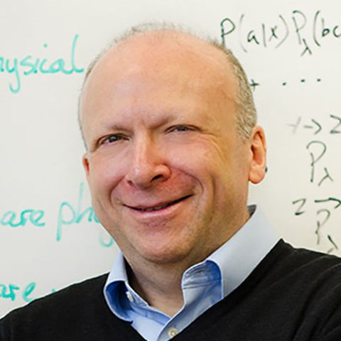 **[Samson Abramsky FRS](https://en.wikipedia.org/wiki/Samson_Abramsky)** Co-inventor of CQM. Emeritus Strachey Professor at Oxford, professor at UCL.
- 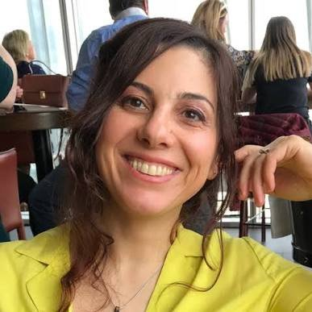 **[Mehrnoosh Sadrzadeh](https://en.wikipedia.org/wiki/Mehrnoosh_Sadrzadeh)** Co-inventor of DisCoCat. Professor at UCL.
- 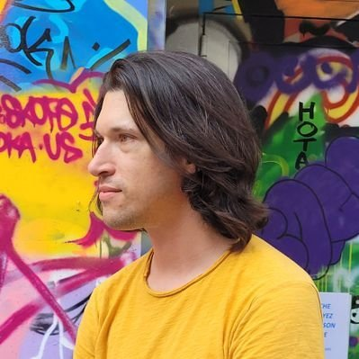 **[Amar Hadzihasanovic](https://ioc.ee/~amar/)** Proved the ZX-calculus complete. Assistant professor at TalTech.
{: .cols-2 .halves .people}

---

Combined team: 150+ PhDs supervised, 500+ papers and 45K citations.
{: .center .tagline}
